<p align="center">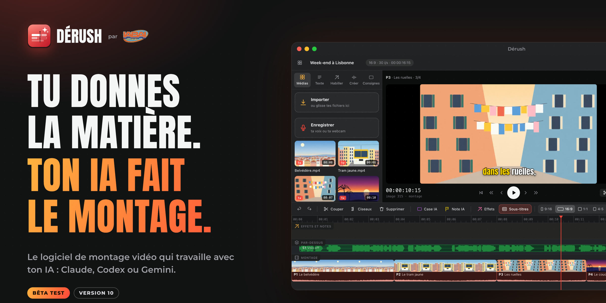</p>

# Dérush par IABAI

**Tu donnes la matière. Ton IA fait le montage.**

Dérush est un logiciel de montage vidéo qui travaille avec ton IA : **Claude**, **Codex** ou **Gemini**, avec ton propre compte. Tu déposes tes vidéos (ou tu enregistres ta voix, ta webcam), tu écris ce que tu veux, et ton IA monte : les plans, les titres, les effets, le son, les sous-titres. Ensuite, tu règles chaque détail d'un mot.

> **Bêta test — version 11.0.** Dérush vient de sortir : tout n'est pas encore parfait. Dis-nous ce qui coince dans l'onglet [Issues](../../issues), c'est le but de la bêta. Il a été essayé sur Mac ; Windows et Linux sont prévus, mais pas encore essayés pour de vrai.

<p align="center">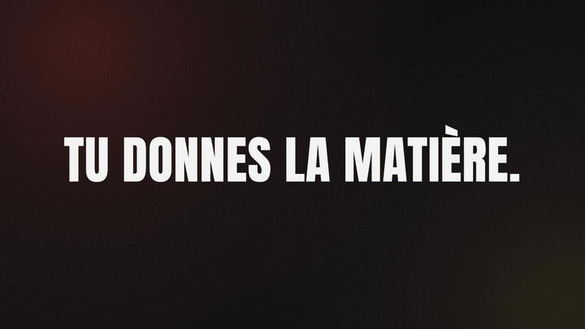</p>

<p align="center"><sub>Un aperçu du trailer de lancement. <a href=".github/medias/trailer-derush.mp4?raw=true"><b>Télécharger le film entier</b></a> (MP4, avec le son). Il a été monté dans Dérush, par une IA, à partir d'un brief et de captures du logiciel.</sub></p>

---

## Installer Dérush

<p align="center">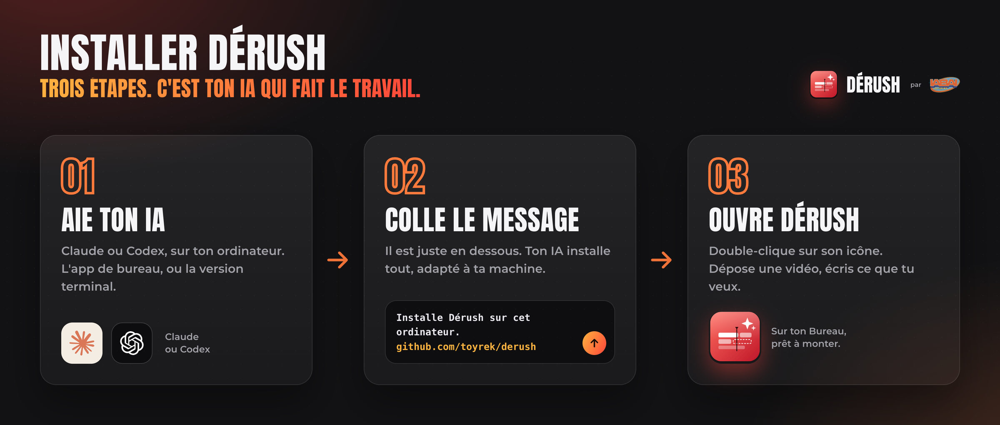</p>

### 1. D'abord, ton IA

Tu n'installes pas Dérush toi-même : **ton IA l'installe pour toi**, et c'est elle qui montera tes vidéos. Il te faut donc Claude ou Codex **sur ton ordinateur** (le site web ne suffit pas : il ne peut rien installer), et l'abonnement qui va avec.

<p align="center">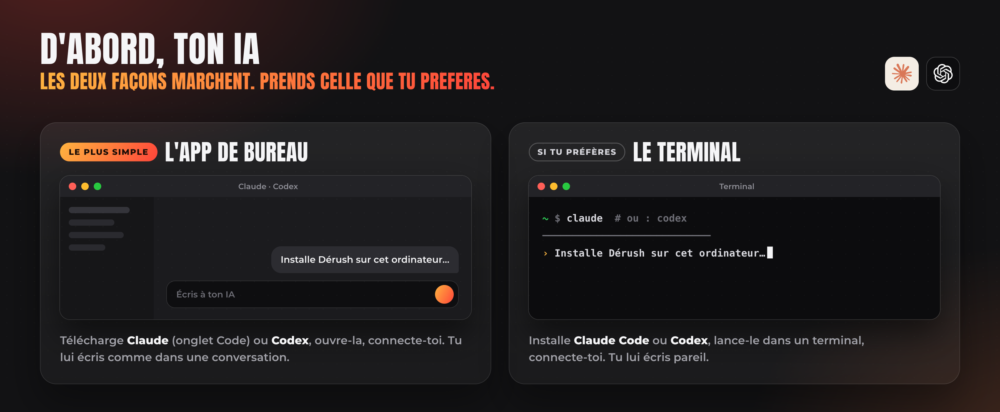</p>

| | L'app de bureau (le plus simple) | Le terminal (si tu préfères) | Le compte qu'il faut |
|---|---|---|---|
|  **Claude** | [Télécharge Claude](https://claude.com/download), ouvre l'onglet **Code** | [Installe Claude Code](https://code.claude.com/docs/en/setup), puis tape `claude` | Claude Pro ou Max |
|  **Codex** | [L'app Codex](https://developers.openai.com/codex/app) (Mac, Windows) | [Installe Codex](https://developers.openai.com/codex/cli), puis tape `codex` | ChatGPT Plus, Pro ou Business |

Une seule suffit. Ouvre-la, connecte-toi, vérifie qu'elle te répond. (Gemini marche aussi : il se branche plus tard, dans Dérush.)

### 2. Colle ce message à ton IA

Copie tout le bloc (le bouton est en haut à droite du bloc), colle-le dans ton IA, envoie.

```text
Installe Dérush sur cet ordinateur. C'est un logiciel de montage vidéo qui travaille avec une IA
(bêta test, par IABAI). Son dépôt : https://github.com/toyrek/derush

1. Il faut Git et Node.js 20.12 ou plus (git --version, node --version). S'il en manque un,
   installe-le avec l'outil de ce système (Homebrew sur Mac, winget sur Windows, le gestionnaire
   de paquets sur Linux).
2. Clone le dépôt dans un dossier « Derush » de mon dossier personnel. S'il existe déjà, mets-le
   à jour (node derush.mjs mettre-a-jour).
3. Lis INSTALLER.md, à la racine du dépôt, et suis-le pas à pas. Lance d'abord
   « node derush.mjs installer --bilan » : il décrit cette machine et conseille la formule
   d'installation qui lui va. Suis ce conseil.
4. À la fin, montre-moi le bilan, et dis-moi en trois lignes comment ouvrir Dérush et brancher
   mon IA dans « Connexions ».

Règles : ne lance aucune commande en administrateur (sudo) sans me la montrer d'abord. Ne me
demande ni mot de passe ni clé dans cette conversation. Ne modifie pas le code de Dérush.
```

Ton IA regarde ta machine, choisit la bonne formule, installe ce qui manque (FFmpeg, les moteurs, les compétences) et pose l'icône de Dérush sur ton Bureau. Compte 5 à 15 minutes. Elle te montre toute commande sensible avant de la lancer.

### 3. Ouvre Dérush

Double-clique sur **Dérush**. Un petit tutoriel animé te montre les gestes. Puis ouvre **Connexions** (la prise, en haut à droite) : ton IA y est déjà, branche le reste si tu veux.

> Sur Mac, à la première ouverture, le système peut dire qu'il ne peut pas vérifier le développeur : *Réglages Système → Confidentialité et sécurité → Ouvrir quand même*, une seule fois.

<details>
<summary><b>Installer à la main, sans IA</b></summary>

Il te faut **Git** et **Node.js 20.12 ou plus** (https://nodejs.org). Puis, dans un terminal :

```bash
git clone https://github.com/toyrek/derush.git Derush
```

```bash
cd Derush
```

```bash
node derush.mjs installer --bilan
```

Le bilan décrit ta machine et conseille la formule. Lance-la (le plus souvent) :

```bash
node derush.mjs installer
```

Options : `--leger` (sans Whisper, 2 Go de moins), `--blender` (ajoute Blender pour la 3D réaliste), `--earshot` (ajoute Earshot, l'oreille de l'IA : 2,5 Go). L'installateur ne lance jamais de commande administrateur : s'il en faut une, il te l'écrit. Le détail, système par système, est dans [INSTALLER.md](INSTALLER.md).

</details>

---

## Comment ça marche

<p align="center">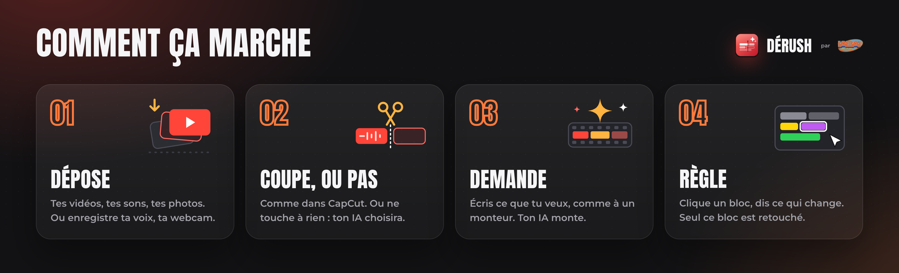</p>

<p align="center">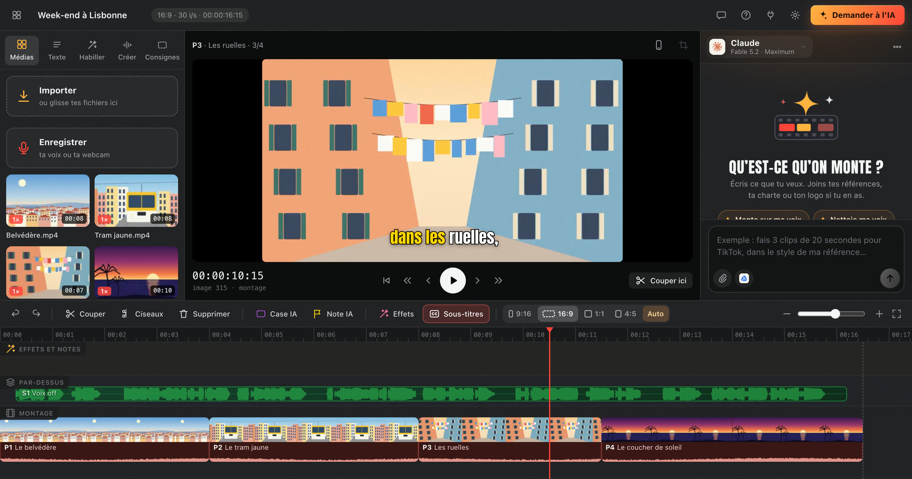</p>

## Cinq façons de créer

<p align="center">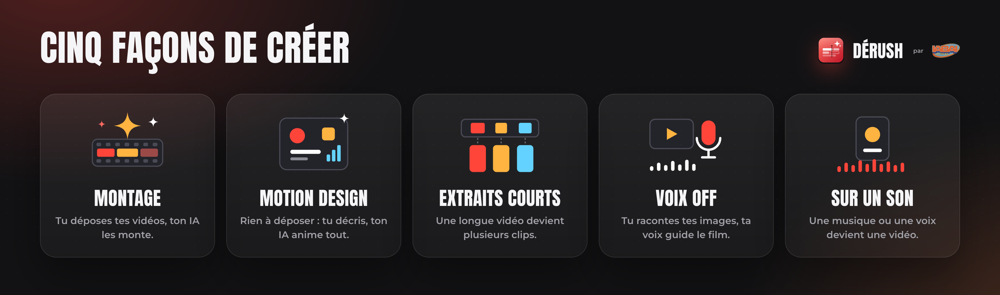</p>

Tu choisis à la création du projet, et tu peux changer ensuite.

## Ta voix, ta webcam

Sous *Importer*, le bouton **Enregistrer**. **Ma voix** : tu racontes pendant que ton montage défile, ta voix se pose en vert sur tes images, son texte s'écrit tout seul, et un clic sur *Sous-titres* les affiche. **Me filmer** : ta webcam et ton micro, pour un podcast ou un face caméra, directement dans ton projet.

| Une prise de voix off | Me filmer |
|---|---|
| 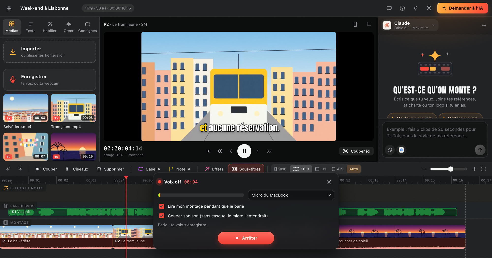 | 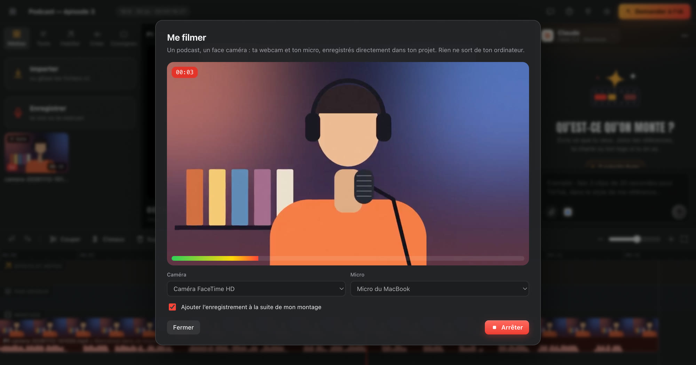 |

## Demande, puis règle

Tu écris comme à un monteur. Ton IA monte, et tout ce qu'elle pose (plans, titres, effets, sons) apparaît en blocs dans la timeline, en direct. Clique un bloc : « Plus tôt », « Plus gros », « Moins fort », « Retirer », ou tes propres mots. Seul ce bloc est retouché.

<p align="center">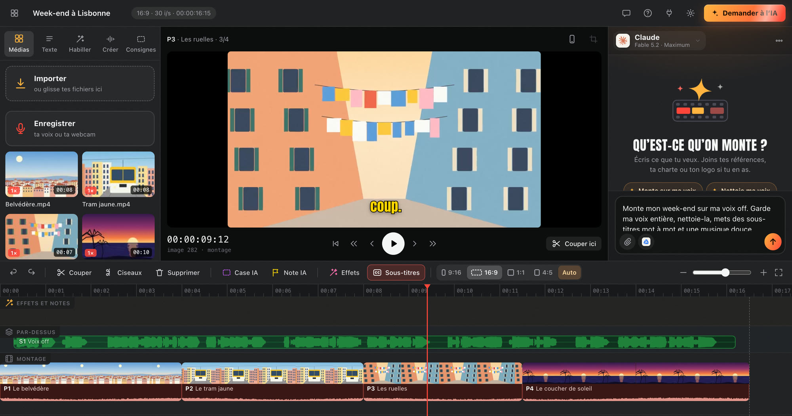</p>

## Tes médias, analysés

À l'import, Dérush regarde et écoute chaque rush : image sombre, plate ou brûlée, dominante de couleur, tourné en **Log**, bruit de fond, voix étouffée, écho. Des pastilles le disent sur les vignettes ; la fiche du média (menu « … ») détaille tout. **Analyser** fait regarder tes rushes par ton IA, sans les poser dans la timeline : ce qu'ils contiennent, leurs meilleurs moments, leurs défauts. Ton IA de montage s'en sert, et voit tous tes médias, même ceux que tu n'as pas posés.

Sélectionne-en plusieurs au lasso (ou ⌘A, ⌘-clic, Maj-clic) et glisse le groupe dans la timeline, d'un geste.

| La sélection et les pastilles | La fiche d'un média : un rush Sony en S-Log3, converti |
|---|---|
| 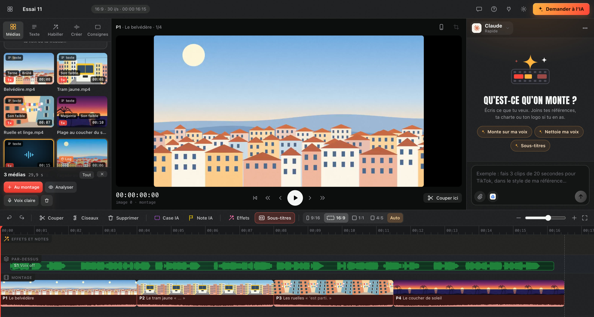 | 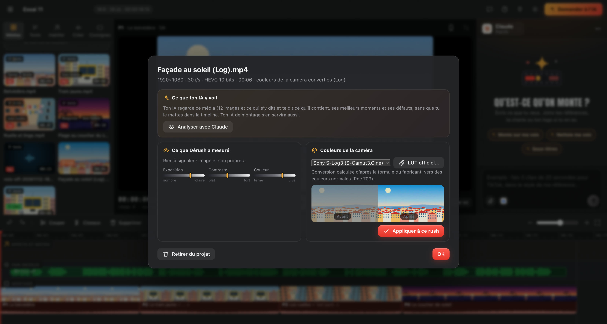 |

## Le son et les couleurs

**Voix claire** : un clic retire le souffle et le bruit de fond, rend une voix étouffée plus nette, réduit l'écho de la pièce, et la met au bon volume, sans jamais la décaler des lèvres. **Couleurs** : chaque plan a ses curseurs (exposition, contraste, saturation, température, teinte), un bouton *Auto*, et *Sur tous les plans* ; ce que tu vois est ce qui sort dans la vidéo. Les rushes filmés en **Log** (Sony, Panasonic, Canon, Fujifilm, Nikon, ARRI, Apple, DJI) sont convertis en couleurs normales, ou avec le LUT officiel de ta caméra. Ton IA fait pareil sur sa vidéo : elle nettoie les voix, mixe (la musique se baisse sous la voix) et étalonne chaque plan.

<p align="center">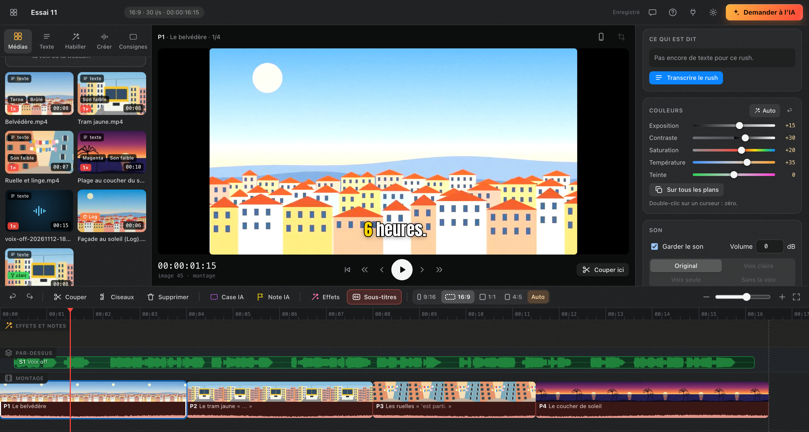</p>

**Ta disposition** : tire les bords des panneaux pour agrandir les médias, l'IA ou la timeline ; double-clic pour revenir. **Pendant que ton IA travaille**, tu peux lui écrire (Claude lit ton message au geste suivant) et continuer ton montage.

---

## Brancher (une fois)

<p align="center">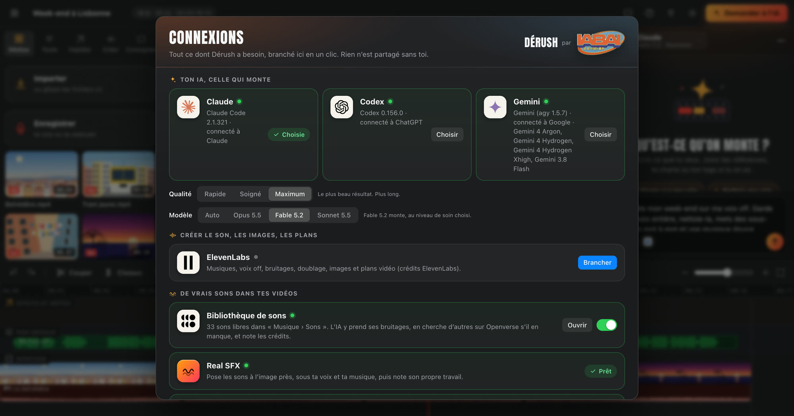</p>

Ouvre Dérush, puis **Connexions** (la prise, en haut à droite). Chaque carte se branche en un clic.

| | Connexion | À quoi ça sert | Comment |
|---|---|---|---|
|  | **Claude** | L'IA qui monte | *Installer*, puis *Me connecter* : ton compte Claude (Pro ou Max) |
|  | **Codex** | L'IA qui monte | *Installer*, puis *Me connecter* : ton compte ChatGPT (Plus, Pro ou Business) |
|  | **Gemini** | L'IA qui monte | *Installer* (la commande `agy` d'Antigravity), puis *Me connecter* : une fenêtre de terminal s'ouvre, tu te connectes avec ton compte Google |
|  | **ElevenLabs** | Musiques, voix off, bruitages, doublage, images, plans vidéo | *Brancher* : tu autorises Dérush dans ton navigateur |
|  | **Bibliothèque de sons** | De vrais bruitages libres de droits (Openverse), rangés dans `Musique › Sons` avec leurs crédits | Un interrupteur |
| 🔊 | **Real SFX** | Poser ces sons à l'image près, sous ta voix et ta musique | *Ajouter* (9 Mo) |
| 👂 | **Earshot** | L'oreille de l'IA : écouter, choisir, fabriquer un son (facultatif) | *Ajouter* (2,5 Go) |
|  | **Google Drive** | Donner tes fichiers du Drive à l'IA, y envoyer tes vidéos | Un interrupteur (il faut Google Drive pour ordinateur) |
|  | **Treg** (conseillé) | Publier sur les réseaux, lire tes chiffres et tes commentaires, dresser ton profil de créateur | *Relier mes réseaux* : trois gestes, Dérush te guide et te montre quels réseaux sont reliés |
|  | **Blender** | La 3D réaliste (facultatif) | *Installer* |

Une seule IA suffit, mais tu peux en brancher plusieurs et passer de l'une à l'autre à tout moment (le nom de l'IA, en haut de la conversation). Trois niveaux de qualité : **Rapide**, **Soigné**, **Maximum**.

Tes comptes restent les tiens : Dérush ne voit jamais tes mots de passe. Les clés (ElevenLabs, Treg) sont rangées dans le dossier de Dérush sur ton ordinateur, jamais dans tes projets ni sur GitHub. L'IA ne reçoit que les connexions que tu lui donnes ici.

---

## Monter, en détail

Deux réglages au-dessus de la timeline :

- **Le format** : `9:16`, `16:9`, `1:1`, `4:5`, ou **Auto** (le format de ta première vidéo). Tu peux mélanger des vidéos de formats différents : chacune est recadrée pour remplir l'image, en suivant les visages. Tu peux aussi demander à l'IA plusieurs formats d'un coup (« fais-en aussi une version 16:9 »).
- **Les sous-titres** : aucun tant que tu ne les demandes pas. Un clic sur *Sous-titres* les met sur tout le film ; leur style se règle dans *Habiller*.

**De vrais sons.** Allume *Bibliothèque de sons* dans Connexions : pour ses bruitages (whoosh, impacts, clics, pops…), l'IA prend de vrais enregistrements libres de droits au lieu de sons de synthèse. Elle en cherche d'autres sur [Openverse](https://openverse.org) quand il en manque, ne garde que ceux qu'on a le droit de poser sur une vidéo commerciale, et te donne sous sa réponse les **crédits à coller** dans ta description quand une licence le demande.

Le manuel complet (tous les gestes, les effets, le studio ElevenLabs, les vrais sons) est dans [docs/MANUEL.md](docs/MANUEL.md).


**Les modes.** À la création d'un projet, choisis *Montage*, *Motion design*, *Extraits courts*, *Voix off* ou *Sur un son*. Tu peux en changer ensuite (menu « … » › *Brief et format*).

**Régler ce que l'IA a posé.** Sous sa vidéo, la timeline montre ses blocs : plans (gris), titres et textes (jaune), effets (violet), sons (vert). Clique un bloc : « Plus tôt », « Plus tard », « Plus gros », « Moins fort », « Retirer », ou tes propres mots. Les réglages partent avec ton prochain message.

**Ton profil de créateur.** Bouton *Mon profil* sur l'écran des projets (ou menu « … »). Il faut Treg relié, et Claude ou Codex. L'analyse prend 5 à 10 minutes, en lecture seule ; tu peux couper « Donner mon profil à mon IA », refaire l'analyse ou tout effacer.

---

## Analyser, puis partager

Sous chaque vidéo livrée (et à la fin de « Créer la vidéo »), deux boutons ouvrent l'écran **Avant de publier**.

**Analyser.** Dérush mesure la vidéo finie (format, durée, niveau du son, coupes, première parole, débit, blancs), puis ton IA lit ce qui est dit, regarde les images, relit ses repères datés sur TikTok, Instagram et YouTube, et cherche ce qui marche en ce moment sur ton sujet. Tu obtiens une note sur 100, une note par réseau, huit points regardés (accroche, histoire, rythme, son, textes à l'écran, format, fin, originalité) avec la preuve de chaque constat, et trois choses à faire en premier. Un clic sur *Demander* met la correction dans ton message à l'IA. C'est une estimation pour améliorer la vidéo : personne ne peut promettre des vues.

**Partager.** Choisis tes réseaux : l'IA écrit pour chacun la légende, les hashtags, le bon moment, l'image de couverture, et une stratégie pour faire circuler la vidéo. Tu relis, tu corriges, tu copies, ou tu publies d'un clic avec [Treg](https://treg.to). Tu peux aussi l'écrire dans la conversation (« publie-la sur TikTok et YouTube »), ou publier tout de suite sans plan (menu ⋯ de la vidéo).

| Réseau | Ce qui se passe |
|---|---|
| **TikTok** | La vidéo arrive en **brouillon** dans ta boîte TikTok ; tu colles la légende (bouton *Copier*) et tu publies depuis l'app. C'est une limite de TikTok pour l'instant. |
| **YouTube Shorts** | Mise en ligne **non répertoriée** par défaut ; *Publique* ou *Privée* si tu le choisis. YouTube a besoin de ta **clé Treg** dans Dérush (Connexions › Treg › *Relier mes réseaux*) : le connecteur Treg d'un compte Claude ne lui suffit pas. |
| **Instagram Reels** | Publiée sur ton compte professionnel. Instagram doit aller chercher la vidéo sur une adresse web : elle passe par un lien public temporaire (une heure). L'IA te le dit. |
| **LinkedIn** | Publiée sur ton profil. |

**Rien ne part sans toi** : l'IA ne publie que si tu cliques *Publier* ou si tu l'écris dans ton message. Chaque publication apparaît sous la vidéo, avec son lien.

---

## Mettre à jour

**Dérush te prévient.** Quand une nouvelle version sort, une petite fenêtre l'annonce dans Dérush, avec ce qui change. *Mettre à jour* l'installe et Dérush redémarre ; *Plus tard* remet l'annonce au lendemain. Ton IA te le dit aussi, une fois, à la fin de sa réponse.

<p align="center">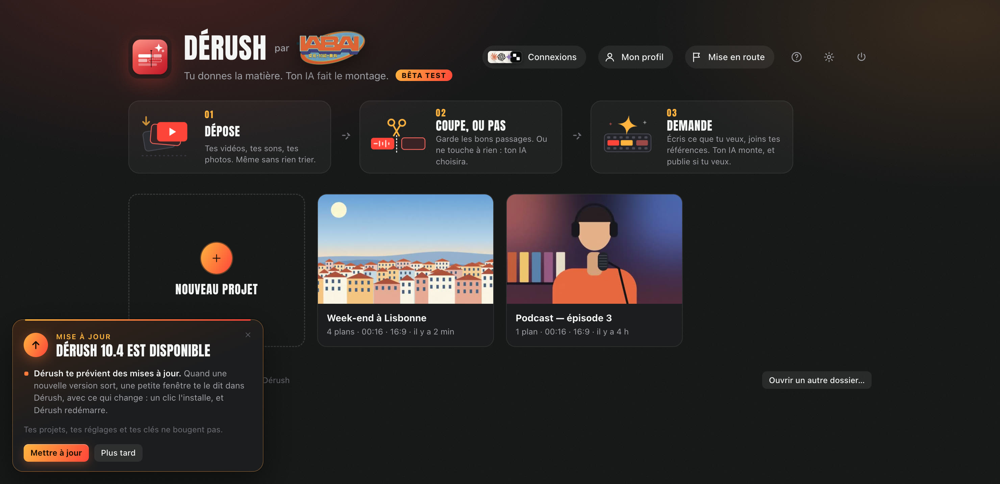</p>

Tu peux aussi le faire à la main : **Connexions → Version → Vérifier**, puis *Mettre à jour*. Ou, dans le dossier de Dérush :

```bash
node derush.mjs mettre-a-jour
```

- Tes projets, tes moteurs et tes clés ne sont pas touchés (ils sont rangés ailleurs, voir plus bas).
- Dérush regarde seulement ce dépôt, au lancement puis toutes les six heures : rien n'est envoyé. Pour ne plus être prévenu, éteins l'interrupteur de **Connexions → Version**.
- Une copie de Dérush reçue en zip ou en image disque est prévenue aussi, mais ne se met pas à jour toute seule : recolle le message d'installation à ton IA.

---

## Questions fréquentes

**Est-ce que mes vidéos sont envoyées quelque part ?** Dérush tourne sur ton ordinateur et n'a aucun serveur à lui : il n'envoie tes fichiers nulle part. Ton IA, elle, travaille avec ton compte : pour monter, elle regarde des images de tes vidéos et lit leur texte, comme quand tu lui montres un fichier. Les services que tu branches toi-même (ElevenLabs pour le son, Treg pour publier) reçoivent ce que tu leur envoies.

**Qu'est-ce qu'il me faut ?** Un ordinateur (8 Go de mémoire au moins, 16 Go pour être à l'aise), et un abonnement à Claude (Pro ou Max) ou à ChatGPT (Plus, Pro ou Business) : c'est ton IA qui travaille, avec ton compte. ElevenLabs et Treg sont facultatifs.

**J'ai seulement Claude ou ChatGPT sur le web. Ça suffit ?** Non : il faut l'app de bureau ou la version terminal. C'est elle qui peut agir sur ton ordinateur, pour installer Dérush puis pour monter.

**Mac, Windows, Linux ?** Dérush est écrit pour les trois, mais il n'a été essayé pour de vrai que sur Mac (puce Apple). Sur Windows et Linux, attends-toi à des accrocs, et dis-les-nous.

**Quelque chose ne marche pas.** Ouvre une [issue](../../issues) : dis ce que tu as fait, ce que tu attendais, ce qui s'est passé. Tu peux aussi le demander à ton IA, dans le dossier de Dérush : elle sait lire son journal.

**Comment désinstaller ?** Supprime le dossier `Derush`, le dossier des moteurs (voir « Où sont rangées les choses ») et l'icône. Tes projets restent : c'est toi qui décides.

---

## Les compétences

Dérush livre **105 compétences** que l'IA lit avant de travailler, et en télécharge 15 de plus (Remotion, Real SFX, le guide d'Earshot) à l'installation ou depuis Connexions :

- **Montage** : FFmpeg (42 outils), étalonnage, mixage du son, sous-titres et traduction, contrôle qualité, motion design, miniatures, images, 3D avec Blender, passage vers Premiere Pro ou DaVinci Resolve ;
- **Son et voix** : les sept compétences ElevenLabs (voix off, bruitages, musique, doublage, transcription…) ;
- **Vrais sons** : `sons-openverse` (chercher des sons libres et noter leurs crédits), Real SFX (les poser à l'image près), Earshot (écouter et fabriquer un son) ;
- **Réseaux** : accroches, scripts TikTok / Reels / Shorts, légendes, hashtags, tendances, carrousels, stratégie, croissance ;
- **Instagram et YouTube, de bout en bout** : 24 compétences de Jake Schincariol (`ig-…`, `yt-…`) — accroches notées sur des formules éprouvées, minutage d'un script, légende vérifiée, titre et miniature jugés ensemble, audit d'un compte par écart à sa médiane ;
- **Publication et créateur** : `derush-viralite` (analyser une vidéo avant de la publier, avec des repères datés et sourcés), `derush-publier` (TikTok, YouTube, Instagram, LinkedIn avec Treg) et `derush-createur` (dresser ton profil de créateur à partir de tes comptes, en lecture seule).

Elles sont dans [competences/](competences/), avec leurs sources et leurs licences ([competences/LICENCES.md](competences/LICENCES.md)).

---

## Où sont rangées les choses

| | macOS | Windows | Linux |
|---|---|---|---|
| Tes projets | `~/Movies/Dérush` | `Vidéos\Dérush` | `~/Videos/Dérush` |
| Tes sons | `~/Music/Sons` | `Musique\Sons` | `~/Music/Sons` |
| Moteurs, clés, réglages | `~/Library/Application Support/Dérush` | `%APPDATA%\Dérush` | `~/.local/share/derush` |
| Le programme | le dossier que tu as cloné | idem | idem |

Rien d'autre n'est installé ailleurs, sauf ce que tu acceptes (FFmpeg, Blender, Claude Code, Codex).

---

## Ce qu'il faut savoir sur cette bêta

- **Windows et Linux** : Dérush a été écrit pour les trois systèmes, mais il n'a été essayé pour de vrai que sur Mac (puce Apple). Sur Windows et Linux, attends-toi à des accrocs : dis-les-nous. La vraie application (sans navigateur) n'existe que sur Mac pour l'instant ; ailleurs, Dérush s'ouvre dans une fenêtre de Chrome, Edge ou Brave.
- **Sur Mac, la première ouverture** : l'app n'est pas encore signée auprès d'Apple. Si macOS dit qu'il ne peut pas vérifier le développeur : *Réglages Système → Confidentialité et sécurité → Ouvrir quand même*, une seule fois.
- **L'analyse de viralité** est une estimation faite par ton IA à partir de mesures et de repères publics : elle aide à améliorer une vidéo, elle ne prédit pas ses vues. Elle utilise ton abonnement Claude ou ChatGPT (une à trois minutes par analyse).
- **Sur Mac seulement** : le recadrage qui suit les visages et le titre « derrière la personne » (ils utilisent Apple Vision).
- **Codex** travaille dans un bac à sable : il écrit dans le dossier du projet, et Dérush fait les rendus pour lui. Claude, lui, travaille directement.
- **La publication** dépend de Treg et de tes comptes : TikTok en brouillon seulement, YouTube limité à quelques envois par jour, Instagram par un lien public temporaire. Elle n'a pas encore été essayée en vrai sur tous les réseaux.
- **Les vrais sons** viennent d'Openverse (Freesound, Wikimedia Commons…). Dérush ne garde que les licences qui permettent une vidéo commerciale (domaine public et CC BY) et note chaque crédit, mais Openverse relaie la licence indiquée par la source sans la garantir : pour une publicité ou un client important, ouvre la page du son avant de publier. 200 recherches par jour au plus. Real SFX et Earshot n'ont été essayés que sur Mac.
- **Remotion**, le moteur de rendu, est gratuit pour les particuliers et les structures de trois personnes au plus ; au-delà, il faut une licence (https://remotion.dev/license).
- **ElevenLabs et Treg** sont des services en ligne : ce que l'IA crée ou publie avec eux utilise tes crédits et tes comptes.

---

## Pour aller plus loin

- [Le manuel](docs/MANUEL.md) : tous les gestes, les effets, le studio ElevenLabs, les vrais sons.
- [Ce qui est nouveau](docs/NOUVEAUTES.md), version après version.
- [Le guide d'installation](INSTALLER.md), celui que ton IA suit.
- [Les repères du dépôt](AGENTS.md), pour qui veut modifier Dérush.

## Licences

Dérush est © 2026 IABAI (association YABAÏ) — bêta test, voir [LICENCE.md](LICENCE.md). Les composants d'autres auteurs gardent leurs licences : [NOTICES.md](NOTICES.md).
